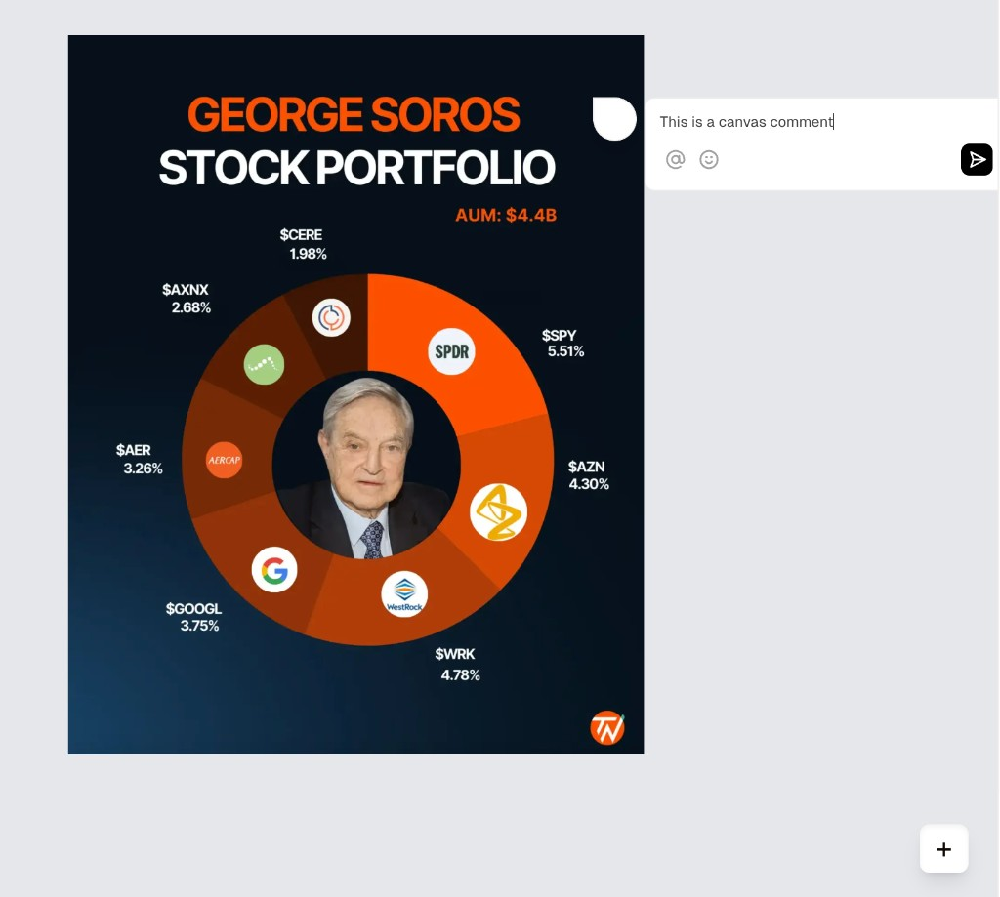
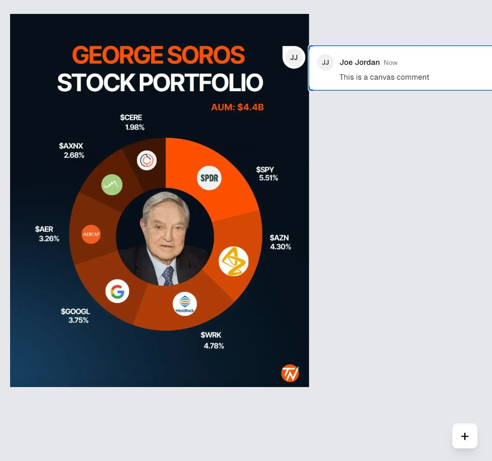

# Full Stack Developer Case Study

Thank you for taking part in our hiring process. This case study is the second stage. It has one required coding task (Part B) and one optional written task (Part A).

**Deadline:** please submit within **72 hours** of receiving this link.

# Rules

1. **AI tools are allowed.** You may use any AI coding tools you like (Copilot, Cursor, Claude, ChatGPT and similar). The team you would join uses AI every day. What matters is that the result is good and that you understand it.
2. **You will explain it live.** If you move to the next stage, you will walk the team through your code and explain your decisions, line by line if asked. Only submit code you can fully explain, whoever or whatever wrote it.
3. **Add an AI usage note.** In your README, add a short section called "AI usage" covering: which tools you used, what you used them for, and at least one thing the AI got wrong or that you changed, and why.
4. **Commit in small steps.** Make regular commits with clear messages as you work. Your commit history helps us see your process.
5. **Partial is fine.** Focus on doing the core features well. A clean, working subset beats a rushed, complete one.

# Part B: Image Commenting App (Required)

Build a React app that lets users add comments to an image on a canvas, similar to commenting in design tools like Figma. Use [Liveblocks](https://liveblocks.io/docs) as the real time collaboration layer.

## Starter code

Start from the official Liveblocks canvas comments example:
[Liveblocks Canvas Comments Example](https://github.com/liveblocks/liveblocks/tree/main/examples/nextjs-comments-canvas)

Clone it, run `npm install` and `npm run dev`, and build from there.

**Liveblocks key:** the example needs a Liveblocks API key. Create a free account at [liveblocks.io](https://liveblocks.io), copy your secret key from the dashboard, and follow the example's README to add it to `.env.local`. Do **not** commit your key.

## Core features

**1. Image comments**

* Click anywhere on the image to add a comment anchored to that exact spot.
* Comment threads flip between left and right alignment based on position. If a comment is too close to the right edge of the image, it should open inwards.
* Comment positions must stay correct at every zoom level, so each comment stays on its original anchor point.

**2. Canvas interactions**

* Drag the image to pan.
* Zoom in and out controls.
* Comments keep their position relative to the image while panning and zooming.

## Optional features

* Responsive design for different screen sizes.
* Editing existing comments.

## Design reference

Use these as a guide. Working functionality matters more than matching the design exactly.

You may improve the design or add libraries if they help usability. Any icon library is fine.

## How we evaluate

Since AI tools are allowed, we care most about the quality of your decisions: how the code is structured, how you solved the hard parts (comments staying anchored through zoom and pan, the left and right flip), how you handle errors, and how well you can explain all of it.

* **Functionality:** does the app work as expected?
* **Code quality:** is the code organised, clean, maintainable and testable?
* **State management:** is state handled efficiently across components?
* **Error handling:** how does the app behave when things go wrong (for example a failed connection, an empty comment, or an image that does not load)?
* **UI and UX:** is the experience thoughtful and easy to use?

**Time expectation:** about 4 hours.

# Part A: Product Thinking (Optional)

This part is optional. Complete it if you have time. It is a good chance to show how you think about building the right thing, not just building things right.

Write your answer in `RESPONSE.md`. No code is needed. Expect about 60 to 90 minutes.

## The request

A customer of a content review platform has asked for this feature:

> "Users should be prevented from submitting for review until all AI suggestions have been actively reviewed and given a response."

## Product context

The platform helps teams prepare content before it goes to a human reviewer for approval. A typical flow:

1. A user creates or edits a piece of content.
2. The platform's AI generates suggestions about issues in that content.
3. The user can look through those suggestions.
4. The user submits the content for human review.

Today, users can submit for review without explicitly responding to the AI suggestions.

You have also heard from three stakeholders:

* One says users skip obvious AI suggestions, which creates unnecessary review rounds.
* Another wants a clearer audit trail showing that suggestions were considered.
* A third worries that a blanket rule will add friction and slow people down.

## Your task

Answer three things in `RESPONSE.md`:

1. **Questions you would ask.** What would you ask the customer or internal stakeholders to understand the problem and avoid building the wrong thing?
2. **How you would learn more without them.** The customer is unavailable for a week. What data, product behaviour, people or other sources would you look at to reduce uncertainty?
3. **A developer ready ticket.** Write the ticket you would hand to engineering. It should be specific enough to estimate and start work, and should clearly list open questions, assumptions and dependencies.

You do not need to design the UI in detail. Make reasonable assumptions and label them clearly. We care more about your thinking than finding one correct answer.

# How to submit

1. Click **Use this template** at the top of this repository to create your own copy (or clone it).
2. Build Part B in your repository, and add setup instructions to your README so we can run it in a few minutes.
3. If you do Part A, write it in `RESPONSE.md`.
4. Push your work to your own GitHub repository. If it is private, give access to this GitHub account.
5. Email the link to **info@limitlessoutsourcing.com** with the subject "Case Study: Your Full Name".

Good luck. We look forward to seeing your work.

Limitless Outsourcing Team
